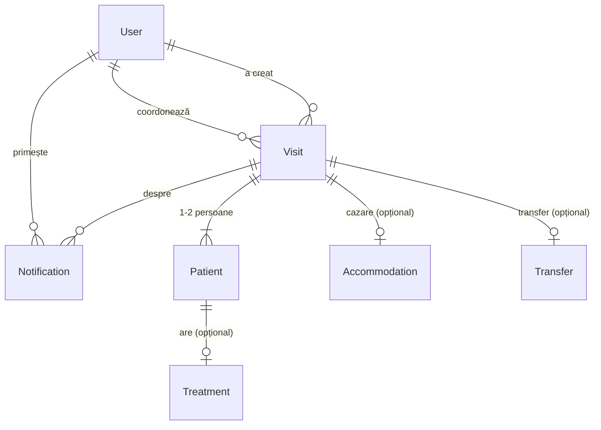

# Arhitectura

## Tehnologii

| Parte | Tehnologie | Publicare |
|---|---|---|
| Frontend | React + Vite + Tailwind CSS v4 | Vercel |
| Backend (API) | Node.js + Express 5 | Render |
| Bază de date | PostgreSQL | Neon |
| Acces la bază | Prisma 6 (schemă + migrări) | — |
| Autentificare | JWT + bcrypt | — |

Cerințe din temă care influențează arhitectura:
- **Responsive:** interfața trebuie să meargă și pe telefon.
- **Minim 50 de utilizatori simultan:** API-ul folosește un singur client Prisma, baza e accesată prin adresa *pooled* din Neon (un „pool” de conexiuni reutilizate), o vizită se citește dintr-o singură interogare (`relationJoins`), iar login-ul nu ține sesiuni pe server (JWT). **Verificat** cu testul de încărcare (`npm run load-test` în `backend`): 50 de utilizatori, 0 erori, 24 de cereri/s; rezultate în [planul 06](planuri/06-test-incarcare.md).
- **Integrare ulterioară cu Bitrix24 și alte aplicații:** totul trece printr-un API REST (`/api/...`), iar vizitele au un câmp `externalId` pentru ID-ul din sistemul extern.
- **Doar date inventate:** baza se umple cu un script de seed.

## Structura repo-ului (monorepo)
```
punto-bianco/
├─ backend/
│  ├─ prisma/
│  │  ├─ schema.prisma        modelul de date
│  │  ├─ migrations/          fișierele SQL generate din schemă (versionate în git)
│  │  └─ seed.js              date demo inventate (npm run seed)
│  ├─ tests/                  teste automate (Vitest + Supertest)
│  ├─ scripts/load-test.js    testul de încărcare: 50 de utilizatori simultan (npm run load-test)
│  ├─ src/
│  │  ├─ app.js               createApp(): aplicația Express — securitate, CORS, rute, erori
│  │  ├─ index.js             pornește aplicația pe un port
│  │  ├─ lib/                 prisma.js (clientul bazei), format.js (ora clinicii), params.js (id din URL),
│  │  │                       dbWriteGuard.js (în ce bază au voie să scrie seed-ul și testele)
│  │  ├─ middleware/          auth.js (token, roluri, doar-citire), validate.js (zod)
│  │  ├─ schemas/             formele acceptate ale datelor: auth.js, visit.js, transfer.js, user.js
│  │  ├─ services/            logică fără HTTP: notificări, evenimente de calendar, forma vizitei
│  │  └─ routes/              auth, users, visits, accommodations, transfers, notifications
│  └─ .env.example            model pentru variabilele de mediu
├─ frontend/
│  ├─ public/
│  │  ├─ brand/               logo-ul decupat (măști pentru dinte și text), favicon, iconița pentru telefon
│  │  └─ fonts/muller/        fontul MULLER (.otf)
│  └─ src/
│     ├─ index.css            Tailwind + sistemul de design (@theme: culori, font, umbre, animații)
│     ├─ fonts.css            declarațiile fontului MULLER
│     ├─ calendar.css         calendarul (FullCalendar) în culorile brandului
│     ├─ api.js               singurul loc care vorbește cu backend-ul (token, timp limită de 20 s, erori)
│     ├─ useApiData.js        încărcarea datelor unei pagini (se încarcă / eroare / date)
│     ├─ auth/                sesiunea: AuthProvider, useAuth, ProtectedRoute
│     ├─ components/          piesele comune ale interfeței (vezi „Sistemul de design”)
│     ├─ pages/               Login, Vizite, Vizită nouă, Detalii, Back office, Cazări, Calendar, Utilizatori
│     ├─ navigation.js        ce pagini vede fiecare rol (meniul)
│     ├─ visitForm.js         starea formularului „Vizită nouă” -> datele trimise la server
│     ├─ transferEvents.js    evenimentele calendarului (textul „Sosire 14:30 – …”, culorile)
│     ├─ labels.js, format.js denumiri în română, data și ora în ora clinicii (afișare și citire din formular)
│     ├─ formStyles.js, cn.js aspectul comun al câmpurilor, unirea claselor CSS
│     ├─ test/                teste automate (Vitest + Testing Library)
│     └─ roles.js             denumirile rolurilor în română
├─ .github/workflows/ci.yml   GitHub Actions (Node 22): schema Prisma, lint fără avertismente, teste, build la fiecare PR
└─ docs/                      documentația (acest folder)
```

## Sistemul de design (frontend)

Stilul e scris cu **Tailwind CSS v4**. Culorile, fontul, umbrele și animațiile sunt definite **într-un singur loc**, în `@theme` din `frontend/src/index.css`. Toate paginile le folosesc prin clase (`bg-mint-300`, `text-ink-700` etc.).

| Element | Valoare |
|---|---|
| Menta brandului | `mint-300` = `#98D3C3`; nuanțele `mint-50` … `mint-900` sunt calculate din ea |
| Griul brandului | `ink-600` = `#565555`; nuanțele `ink-50` … `ink-950` |
| Font | **MULLER**: Medium pentru text, ExtraBold pentru titluri; **Muller Narrow** (`font-narrow`) pentru textele din calendar |
| Iconițe | Phosphor (`@phosphor-icons/react`), importate una câte una (`@phosphor-icons/react/Bell`), ca testele și build-ul să nu încarce toate cele 1.500 de iconițe |
| Forme | câmpuri și butoane cu colțuri de 12 px, carduri de 16 px, insigne rotunde |
| Contrast | pe mentă se scrie cu gri foarte închis (~9:1), niciodată cu alb; textul secundar (`ink-500`) are 5,2:1 pe alb |

**Logo-ul** e refăcut din fișierul original (`brand/logo-punto-bianco.png`, alb, făcut pentru fundal închis). Dintele și textul „PUNTO BIANCO” sunt decupate ca **măști** (`public/brand/tooth-mask.png`, `wordmark-mask.png`), deci păstrează desenul și literele originale, dar pot fi colorate cu orice culoare a brandului (componenta `Logo`).

**Componentele comune** (`frontend/src/components/`):

| Componentă | Ce face |
|---|---|
| `AppLayout` | cadrul: bara laterală (calculator), bara de sus și meniul glisant (telefon), clopoțelul |
| `Button`, `Logo`, `StatusBadge`, `PageHeader`, `Panel` | buton (3 variante), logo, insigna de status (culoare + iconiță), antetul paginii, panou cu titlu |
| `FormField`, `Switch`, `SegmentedControl`, `RadioCards`, `Listbox` | câmpuri de formular: text (cu asterisc la cele obligatorii), comutator, butoane segmentate, carduri selectabile, listă de alegere proprie (coordonatorul) |
| `FormSection` | secțiune numerotată a unui formular lung |
| `PageState`, `Skeleton`, `EmptyState`, `Loader`, `ErrorBoundary` | stările unei pagini: schelet la încărcare, eroare (cu „Reîncearcă” doar când are rost: rețea sau eroare de server), listă goală, „Se încarcă…”, mesaj în loc de ecran alb la o eroare neașteptată |
| `NotificationBell`, `StatusSummary`, `ScrollToTop` | clopoțelul, rezumatul pe statusuri, derularea la începutul paginii la fiecare schimbare de pagină |
| `Meta`, `HomeRedirect` | iconiță + valoare (sosire, plecare, coordonator în carduri); pagina „/”, care trimite fiecare rol la prima lui pagină |
| `PasswordToggle` | butonul cu ochi care arată / ascunde parola (login, cont nou); `FormField` îl primește prin `action` |

**Telefon:**
- **Meniul** e un panou care glisează din stânga. Se închide la orice schimbare de pagină (inclusiv butonul Înapoi al telefonului); cât e deschis, pagina din spate e inactivă, iar la închidere focusul revine pe butonul ☰.
- **Listele:** Vizite e tabel doar de la 1280 px; mai îngust, fiecare vizită e un card.
- **Câmpurile** au text de 16 px, ca iPhone să nu mărească singur pagina.
- **Comutatoarele** răspund la prima atingere: tot rândul e ținta, fără așteptarea pentru dublă atingere.
- **Butoanele formularului** stau la final; sunt lipite jos doar pe ecrane late, cu mouse.

## Securitate și autentificare

**Fluxul de login:**
1. `POST /api/auth/login` primește **exact** `{ email, password }`, ambele text. Validarea se face cu zod, în mod strict: orice câmp în plus sau tip greșit → 400.
2. Parola e verificată cu bcrypt. Pentru un email inexistent, o parolă greșită sau un cont inactiv, răspunsul e același („Email sau parolă greșite”), cu același timp de răspuns.
3. Serverul trimite înapoi un token JWT (HS256, valabil 8 ore). Frontend-ul îl trimite la fiecare cerere în `Authorization: Bearer`.

**Fiecare cerere protejată trece prin:**
- `requireAuth`: verifică token-ul și încarcă userul **din bază**, ca un cont dezactivat să-și piardă accesul imediat;
- `readOnlyGuard`: Contabil și Control calitate pot face doar GET;
- `requireRole(...)`: pe rutele care cer un anumit rol; Admin are acces peste tot.

**Alte protecții:**
- **Limita de încercări:** 10 login-uri eșuate / 15 minute **pe cont** (email + IP) și 100 / 15 minute **pe IP** → 429. Un cont atacat e blocat fără să-i blocheze pe colegii de la același IP (toată clinica are același IP). IP-ul din `X-Forwarded-For` e luat în considerare doar cu `TRUST_PROXY`.
- **CORS:** API-ul poate fi chemat din browser doar de pe `FRONTEND_URL`.
- **helmet:** header-ele HTTP de securitate standard.
- **Corp JSON de maxim 10 KB.**
- **Erorile interne** nu trimit detalii tehnice clientului.

Ascunderea paginilor în frontend e doar pentru comoditate; protecția reală e întotdeauna în backend. Testul `tests/access.test.js` încearcă fiecare rol pe fiecare rută protejată.

**Sesiunea în browser** (`api.js`, `AuthProvider`):
- tokenul stă în `localStorage`; dacă browserul îl blochează (mod privat), se ține în memorie până la închiderea paginii;
- ieșirea din cont într-un tab închide sesiunea în toate tab-urile (evenimentul `storage`), ca datele pacienților să nu rămână pe un ecran uitat deschis;
- un 401 deconectează doar dacă cererea a plecat cu tokenul curent (un răspuns întârziat nu închide o sesiune nouă);
- o cerere fără răspuns în 20 s se oprește cu „Serverul nu răspunde”.

**Datele medicale** (tratament, disponibilitate) le văd doar rolurile care au nevoie de ele. Managerul de cazări vede detaliile **doar** pentru vizitele cu cerere de cazare (altfel 404, ca pentru o vizită inexistentă) și **fără** tratament și disponibilitate.

**Uneltele care scriu în bază** (seed-ul, care șterge tot, testul de integrare și testul de încărcare) rulează doar dacă host-ul din `DATABASE_URL` e cel din `DB_WRITE_HOST` (`src/lib/dbWriteGuard.js`). Adresa producției pusă din greșeală în `.env` nu poate fi ștearsă.

## Roluri

| Rol (în cod) | Denumire | Acces |
|---|---|---|
| `ADMIN` | Admin | tot, inclusiv **utilizatorii**: creează conturi, le dezactivează / reactivează |
| `COORDONATOR` | Coordonator tratament | înregistrează vizitele pacienților |
| `BACK_OFFICE` | Back office | lista vizitelor, statusuri Început / Finalizat |
| `MANAGER_CAZARI` | Manager cazări | cererile de cazare, Neprelucrat → Rezervat |
| `SOFER` | Șofer | calendarul transferurilor |
| `CONTABIL` | Contabil | **doar citire** |
| `CONTROL_CALITATE` | Control calitate | **doar citire** |

**Conturile** le creează Admin-ul din pagina „Utilizatori” (pe lângă cele demo din seed):
- parola inițială o alege Admin-ul (minim 8 caractere) și i-o comunică colegului;
- conturile nu se șterg, se **dezactivează**: vizitele păstrează coordonatorul și autorul;
- un cont dezactivat pierde accesul **imediat**, chiar dacă e conectat (`requireAuth` citește utilizatorul din bază la fiecare cerere): nu mai poate intra, nu mai apare în lista de coordonatori și nu mai primește notificări.

## Fluxul vizitei

1. **Coordonatorul înregistrează vizita** (pagina „Vizită nouă” → `POST /api/visits`).
   - Datele trec prin validarea strictă din `schemas/visit.js`: câmpurile în plus sunt respinse, iar plecarea trebuie să fie după sosire. Dacă însoțitorul are tratament, textul lui e obligatoriu.
   - După o eroare, formularul derulează la primul câmp greșit; eroarea unui câmp dispare când e corectat.
   - Coordonatorul responsabil trebuie să fie un coordonator activ.
2. **Într-o singură tranzacție** se salvează vizita, persoanele, tratamentele, cazarea, transferul **și notificările**. Fie se salvează tot, fie nimic.
3. **Cine e anunțat** (`services/notifications.js`):
   - fiecare utilizator **Back office** activ: „Vizită nouă: Marco Rossi (+ însoțitor), sosire 02.11.2026 14:30”;
   - fiecare **Manager cazări** activ, **doar dacă vizita are cazare**: „Cerere de cazare: Marco Rossi – Studio, gratuită 3 zile, 02.11–09.11”;
   - **Șoferul nu primește notificare**: vede transferul în calendar.
4. **Clopoțelul** din antet (Back office, Manager cazări) verifică notificările la 30 de secunde și când utilizatorul revine în tab.
5. **Statusurile** se schimbă doar înainte, pas cu pas:
   - Back office: `NEPRELUAT` → `INCEPUT` → `FINALIZAT`;
   - cazare: `NEPRELUCRAT` → `REZERVAT`.

   Actualizarea are condiție pe statusul curent. Dacă doi oameni apasă în același timp, doar primul reușește; al doilea primește **409** și lista se reîncarcă. În pagină, fiecare card își blochează butonul cât se salvează, deci aceeași apăsare nu pleacă de două ori.
6. **Calendarul șoferului** (`services/transferEvents.js`):
   - `SOSIRE` → un eveniment la ora sosirii;
   - `PLECARE` → la ora plecării;
   - `DUS_INTORS` → ambele.

   În pagină, textul e „Sosire 14:30 – Nume pacient(i)”.

**Ora:** în bază orele sunt în UTC. Toată aplicația lucrează în ora clinicii, **Europe/Chisinau**, cu trecerea automată la ora de vară sau de iarnă, **oricare ar fi fusul orar al calculatorului sau telefonului**:
- textele (notificări, liste, detalii) le afișează în ora clinicii (`format.js`, `lib/format.js`);
- ora scrisă în formular e citită ca ora clinicii (`clinicLocalToIso`); o dată imposibilă (luna 13, ora 24) e respinsă;
- calendarul șoferului (grila, „azi”, linia orei curente) e pe ora clinicii (`timeZone` + extensia `@fullcalendar/luxon3`).

## API

Toate rutele de mai jos, în afară de login și health, cer `Authorization: Bearer <token>`. Admin are acces peste tot; Contabil și Control calitate pot face doar GET.

| Metodă | Rută | Cine | Ce face |
|---|---|---|---|
| GET | `/api/health` | oricine | verificare că serverul rulează |
| POST | `/api/auth/login` | oricine | login → token |
| GET | `/api/auth/me` | conectat | utilizatorul curent |
| GET | `/api/users/coordinators` | conectat | coordonatorii activi (lista din formular) |
| GET | `/api/users` | Admin | toți utilizatorii (fără hash-ul parolei), întâi cei activi |
| POST | `/api/users` | Admin | `{ fullName, email, role, password }` → cont nou (parola salvată doar ca hash bcrypt); email existent → 409 |
| PATCH | `/api/users/:id/active` | Admin | `{ "active": true \| false }`; propriul cont nu se poate dezactiva (400) |
| GET | `/api/visits` | Coordonator, Back office, Contabil, Control calitate | vizitele, ordonate după sosire |
| GET | `/api/visits/:id` | aceiași + Manager cazări | detaliile unei vizite; Managerul de cazări: doar vizitele cu cazare (altfel 404), fără tratament și disponibilitate |
| POST | `/api/visits` | Coordonator | înregistrează vizita + notificările |
| PATCH | `/api/visits/:id/back-office-status` | Back office | `{ "status": "INCEPUT" \| "FINALIZAT" }` |
| GET | `/api/accommodations` | Manager cazări, Contabil, Control calitate | cererile de cazare, ordonate după sosire |
| PATCH | `/api/accommodations/:id/status` | Manager cazări | `{ "status": "REZERVAT" }` |
| GET | `/api/transfers?from=…&to=…` | Șofer, Contabil, Control calitate | evenimentele de calendar din interval (maxim 62 de zile) |
| GET | `/api/notifications` | conectat | ultimele 20 de notificări proprii + numărul celor necitite |
| PATCH | `/api/notifications/:id/read` | conectat | marchează o notificare proprie ca citită |
| POST | `/api/notifications/read-all` | conectat | marchează toate notificările proprii ca citite |

**Coduri de răspuns:**
- 400: date invalide, cu `details: [{ field, message }]` pentru fiecare câmp;
- 401: fără login sau sesiune expirată;
- 403: rolul nu are voie;
- 404: nu există;
- 409: statusul a fost deja schimbat; emailul unui cont nou e deja folosit.

Aceeași API poate fi folosită ulterior de Bitrix24 sau de alte aplicații.

## Modelul de date

Tabelul central e **Visit** (vizita / sejurul): o venire a unui pacient la clinică, cu sosire, plecare și coordonatorul responsabil. De vizită țin persoanele, cazarea și transferul.



| Tabel | Ce conține |
|---|---|
| `User` | contul unui membru al echipei: email, parolă (doar hash bcrypt), nume, rol, activ/inactiv |
| `Visit` | sosirea și plecarea (dată + oră, salvate în UTC), dacă vine cu însoțitor, coordonatorul, statusul Back office (`NEPRELUAT` → `INCEPUT` → `FINALIZAT`, cu momentele de început/sfârșit), `externalId` pentru Bitrix24 |
| `Patient` | o persoană din vizită: pacientul principal sau însoțitorul (`isCompanion`), plus disponibilitatea în timpul sejurului (comentariu) |
| `Treatment` | tratamentul (text liber) al unei persoane; însoțitorul fără tratament nu are rând aici |
| `Accommodation` | tipul apartamentului (studio / 1 dormitor + divan / 2 dormitoare / 2 dormitoare + living), dacă e gratuită și pentru câte zile, statusul `NEPRELUCRAT` / `REZERVAT` |
| `Transfer` | gratuit sau contra cost, direcția: `SOSIRE`, `PLECARE` sau `DUS_INTORS` |
| `Notification` | o notificare pentru un utilizator, legată de o vizită, cu marcajul „citit”; tipuri folosite: `VIZITA_NOUA_BACK_OFFICE`, `CAZARE_NOUA` (`TRANSFER_NOU` există în schemă, dar nu e folosit: șoferul nu primește notificări) |

Reguli de citit în model:
- **Lipsa unui rând înseamnă „nu e nevoie”:** dacă o vizită nu are rând în `Accommodation`, pacientul nu are nevoie de cazare. La fel pentru `Transfer`.
- **Ștergerea în cascadă:** ștergerea unei vizite șterge automat persoanele, tratamentele, cazarea, transferul și notificările ei.
- **Calendarul șoferului** nu are tabel propriu: se construiește din `Transfer`, din orele vizitei (`arrivalAt` / `departureAt`) și din numele persoanelor.

Schema completă: [backend/prisma/schema.prisma](../backend/prisma/schema.prisma).
