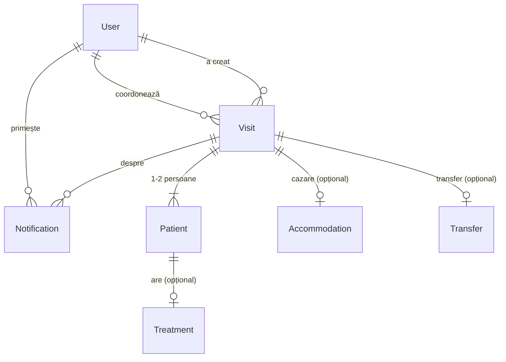

# Arhitectura

## Tehnologii

| Parte | Tehnologie | Publicare |
|---|---|---|
| Frontend | React + Vite | Vercel |
| Backend (API) | Node.js + Express 5 | Render |
| Bază de date | PostgreSQL | Neon |
| Acces la bază | Prisma 6 (schemă + migrări) | — |
| Autentificare | JWT + bcrypt | — |

Cerințe din temă care influențează arhitectura:
- **Responsive:** interfața trebuie să meargă și pe telefon.
- **Minim 50 de utilizatori simultan:** API-ul folosește un singur client Prisma, iar baza e accesată prin adresa *pooled* din Neon (un „pool” de conexiuni reutilizate).
- **Integrare ulterioară cu Bitrix24 și alte aplicații:** totul trece printr-un API REST (`/api/...`), iar vizitele au un câmp `externalId` pentru ID-ul din sistemul extern.
- **Doar date inventate:** baza se umple cu un script de seed.

## Structura repo-ului (monorepo)
```
punto-bianco/
├─ backend/
│  ├─ prisma/
│  │  ├─ schema.prisma        modelul de date
│  │  └─ migrations/          fișierele SQL generate din schemă (versionate în git)
│  ├─ src/index.js            serverul Express
│  └─ .env.example            model pentru variabilele de mediu
├─ frontend/                  aplicația React (Vite)
└─ docs/                      documentația (acest folder)
```

## Roluri

| Rol (în cod) | Denumire | Acces |
|---|---|---|
| `ADMIN` | Admin | tot |
| `COORDONATOR` | Coordonator tratament | înregistrează vizitele pacienților |
| `BACK_OFFICE` | Back office | lista vizitelor, statusuri Început / Finalizat |
| `MANAGER_CAZARI` | Manager cazări | cererile de cazare, Neprelucrat → Rezervat |
| `SOFER` | Șofer | calendarul transferurilor |
| `CONTABIL` | Contabil | **doar citire** |
| `CONTROL_CALITATE` | Control calitate | **doar citire** |

## Modelul de date

Tabelul central e **Visit** (vizita / sejurul): o venire a unui pacient la clinică, cu sosire, plecare și coordonatorul responsabil. De vizită țin persoanele, cazarea și transferul.



| Tabel | Ce conține |
|---|---|
| `User` | contul unui membru al echipei: email, parolă (doar hash bcrypt), nume, rol, activ/inactiv |
| `Visit` | sosirea și plecarea (dată + oră, salvate în UTC), dacă vine cu însoțitor, coordonatorul, statusul Back office (`NEPRELUAT` → `INCEPUT` → `FINALIZAT`, cu momentele de început/sfârșit), `externalId` pentru Bitrix24 |
| `Patient` | o persoană din vizită: pacientul principal sau însoțitorul (`isCompanion`), plus disponibilitatea în timpul sejurului (comentariu) |
| `Treatment` | tratamentul (text liber) al unei persoane; însoțitorul fără tratament nu are rând aici |
| `Accommodation` | tipul apartamentului (studio / 1 dormitor + divan / 2 dormitoare / 2 dormitoare + living), dacă e gratuită și pentru câte zile, statusul `NEPRELUCRAT` / `REZERVAT` |
| `Transfer` | gratuit sau contra cost, direcția: `SOSIRE`, `PLECARE` sau `DUS_INTORS` |
| `Notification` | o notificare pentru un utilizator, legată de o vizită, cu marcajul „citit” |

Reguli de citit în model:
- **Lipsa unui rând înseamnă „nu e nevoie”:** dacă o vizită nu are rând în `Accommodation`, pacientul nu are nevoie de cazare. La fel pentru `Transfer`.
- **Ștergerea în cascadă:** ștergerea unei vizite șterge automat persoanele, tratamentele, cazarea, transferul și notificările ei.
- **Calendarul șoferului** nu are tabel propriu: se construiește din `Transfer`, din orele vizitei (`arrivalAt` / `departureAt`) și din numele persoanelor.

Schema completă: [backend/prisma/schema.prisma](../backend/prisma/schema.prisma).
